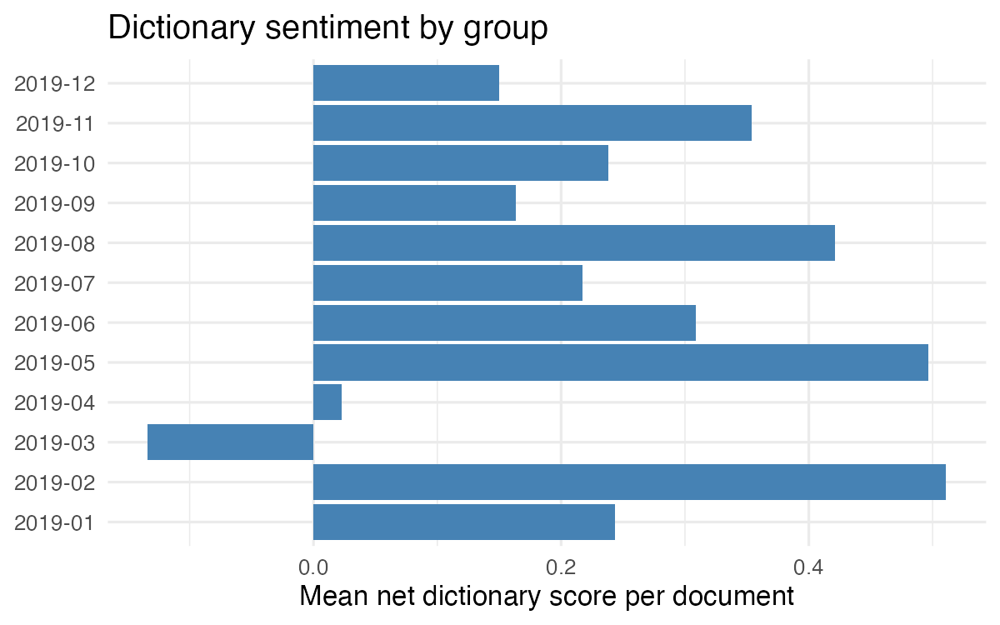
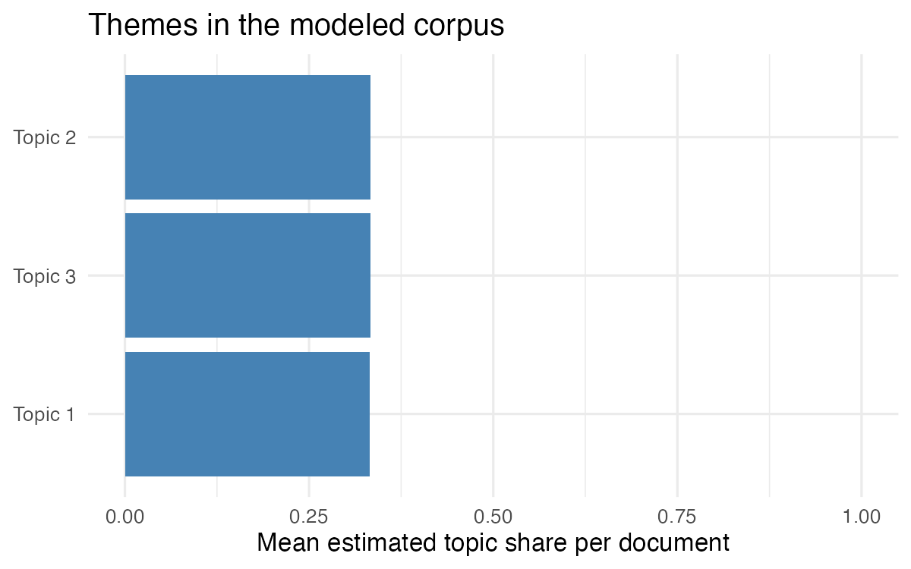

<!-- Run W9-1–8 first, then replace every bracketed prompt below and Render.
     Keep the existing layout. Both PNGs come from your R script. -->

::: {.poster}
::: {.column-one}
## Question

[State one question that both sentiment and topics help answer.]

### Data

[Name the source, date range, selection rule, number of documents, and what one row represents.]

### Methods

**Sentiment:** [Name your dictionary. Explain that you summed matched values within each document and averaged document scores by group. Report coverage.]

**Topics:** [State your preprocessing, chosen k and why, and how many documents retained words for modeling. Explain that you checked keywords against original texts.]
:::

::: {.column-two}
## Sentiment finding

[State one finding from your sentiment figure.]

{fig-alt="Mean document dictionary scores by comparison group."}

[Caption: identify the corpus, groups, and what the bars measure.]

## Topic finding

[State one finding using the topic labels you developed from words and texts.]

{fig-alt="Average estimated topic proportions across modeled documents."}

[Caption: identify the modeled corpus, k, and what the bars measure.]
:::

::: {.column-three}
## Check the original texts

**Sentiment:** [Quote a short passage with its document ID or source link. Explain whether its score captures the wording.]

**Topics:** [Give keywords and a short passage that support one label. Include an ambiguous example.]

### Limits

**Sentiment:** [Describe a concrete mismatch or context the dictionary misses.]

**Topics:** [Describe a mixed theme, sensitivity to a choice, or limitation of your labels.]

### Answer to the question

[Connect the two findings. State what this corpus can and cannot establish.]
:::
:::

::: {.small-source}
**Sources:** [Cite your corpus and sentiment dictionary. Include the source links and selection dates needed to identify your data.]
:::
