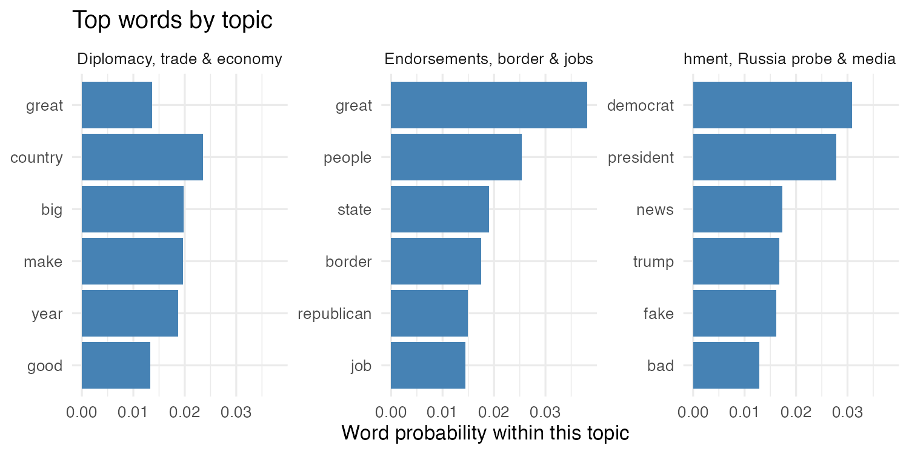
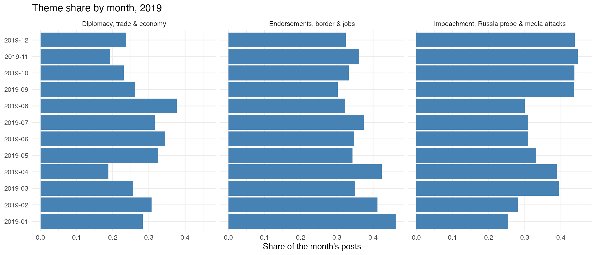
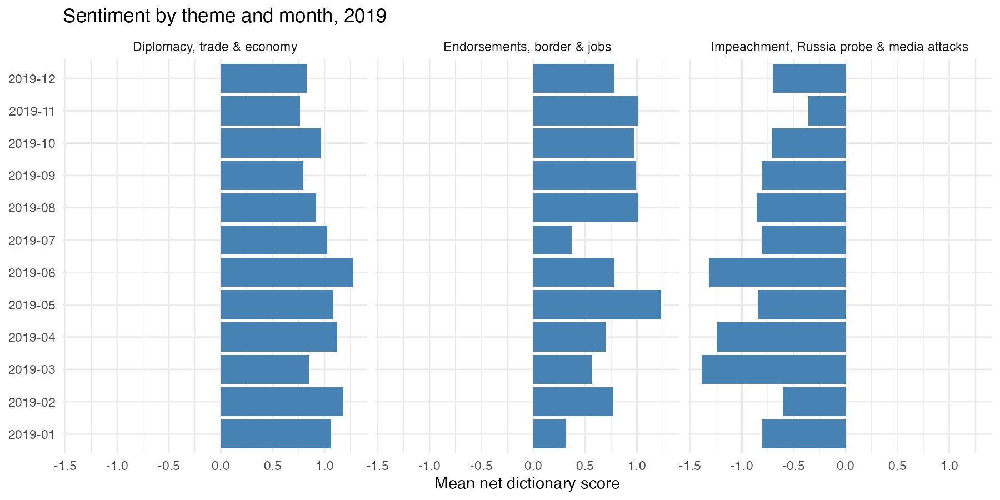
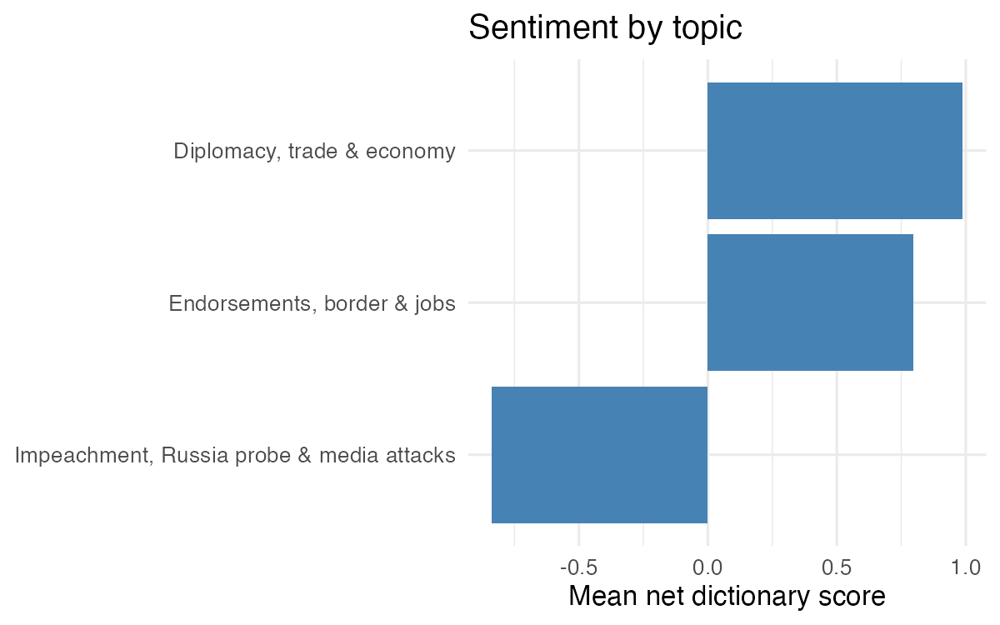
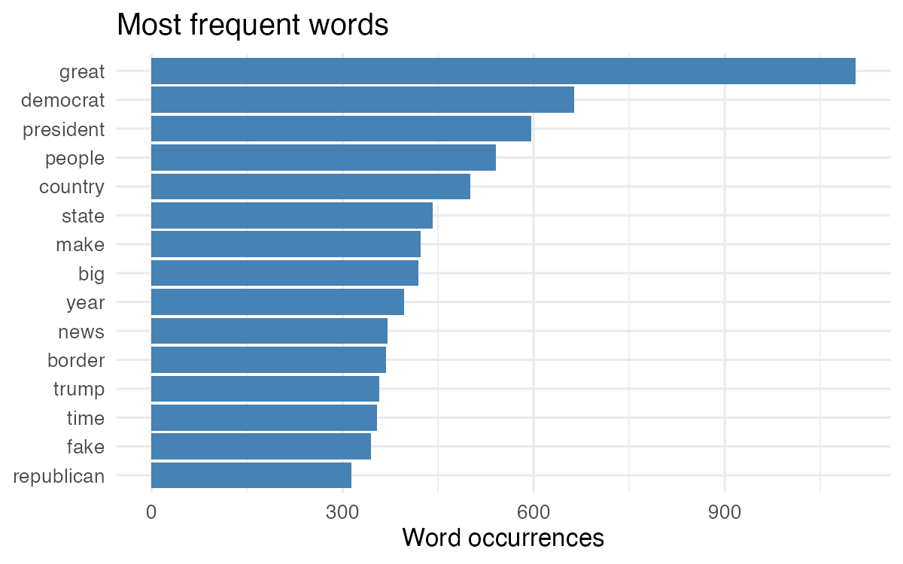
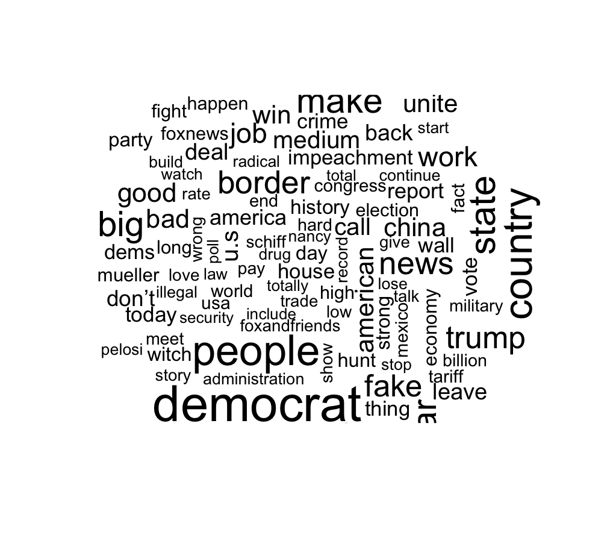
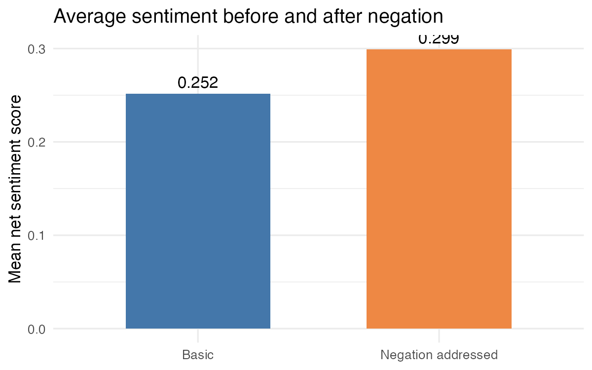
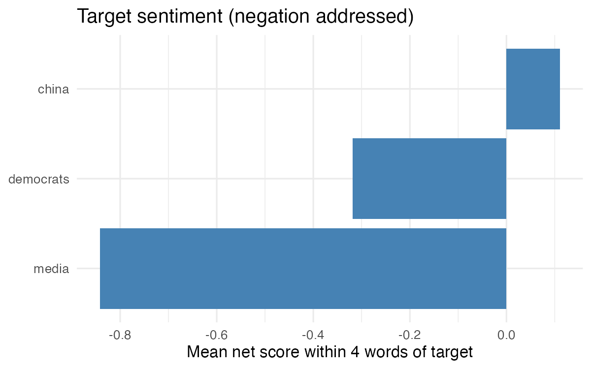

::: {.poster}
::: {.column-one}
## Question

Is negative tone in Trump's 2019 posts concentrated in conflict themes (impeachment, the Russia probe, the media) rather than policy and diplomacy themes, and does it shift over the year?

*Expectation:* negativity is concentrated in the conflict theme, with endorsements and diplomacy staying positive.

### Data

4,469 posts from one account, January–December 2019; one row is one post. Retweets, records without text and one duplicate were removed. These are one account's messages, not public opinion.

### Methods

**Sentiment:** Bing-Liu dictionary (+1/−1; 6,556 words), summed per post. About 9–13% of words match. A two-word lookback handles negation; target tone uses a four-word window.

**Topics:** LDA, k = 3 (Gibbs, seed 4130), lemmatized words, stopwords removed. 4,441 posts modeled; 28 had no retained words. k = 2 merged endorsements/border with diplomacy/economy; k = 4 split endorsements/border further, but I could support only three themes with original posts.
:::

::: {.column-two}
## Topic finding

Three themes, labeled from keywords and original posts: impeachment/Russia/media (36.8% of posts by strongest topic), endorsements/border/jobs (35.6%) and diplomacy/trade/economy (27.6%).

{fig-alt="Top six words for each of three topics, with labels."}

Top words per topic (LDA, k = 3, 4,441 modeled posts). Bars show word probability within a topic.

{fig-alt="Share of each month's posts by theme, 2019."}

The impeachment/media theme grows from about 25–31% of posts in early and mid-year months to about 44% in September–December.

## Sentiment finding

{fig-alt="Mean net dictionary score by topic and month, 2019."}

The impeachment/media theme is negative in all 12 months (−0.36 in November to −1.39 in March). The other two themes are positive in all 12. March was the only negative month overall (−0.13), consistent with that theme being largest and most negative then.
:::

::: {.column-three}
## Check the original texts

**Sentiment, useful (post 675, net −7):** about the media and the Russia probe. "Corrupt," "fake" and "enemy" capture real hostility; "collusion" names the allegation, so the score overstates strength. Negation correctly flipped "No Collusion" (to −5).

**Sentiment, misleading (post 607, net −6):** most scored words ("dark," "stain," "worse") come from a quotation about John McCain, not the media.

**Topics:** *Endorsements/border:* 4127 (endorsement) and 435 (border; mixes two ideas). *Impeachment/media:* 3588 ("Scam") and 1069 (media). *Diplomacy/economy:* 3938 (Federal Reserve meeting) and 321 (North Korea summit).

These are top-weighted or most extreme posts, not typical ones.

### Limits

**Sentiment:** About 10% of words match; the dictionary misses sarcasm, quotations and who a word is about. Negation and target windows are crude, and window tone is near, not about, a mention.

**Topics:** Topic 3 is loose, k is a judgment call, and the tone gap is partly circular: "fake" and "bad" are keywords of the negative topic.

### Answer to the question

Negative tone is concentrated, not evenly spread. Impeachment, Russia and media posts are negative in every month; endorsement/border and diplomacy/economy posts are positive in every month. The negative theme grows in the fall while becoming less negative. This describes how a dictionary scores one account's posts, not the president's beliefs, public reaction or why the pattern changes.
:::
:::

::: {.hero}
## Where is the negative tone?

Negative tone is concentrated in one theme: impeachment/Russia/media averages −0.84 per post, while endorsements/border (+0.80) and diplomacy/economy (+0.99) are positive.

{fig-alt="Mean net dictionary score by topic."}

Mean net dictionary score per post, by strongest topic (4,441 modeled posts, 2019).
:::

::: {.support}
## Supporting results

::: {.support-grid}
::: {.cell-item}
{fig-alt="Bar chart of the 15 most frequent lemmas."}

Most frequent words: "great" (1,105), "democrat" (663), "president" (596).
:::

::: {.cell-item}
{fig-alt="Word cloud of frequent lemmas."}

Word size shows frequency, not tone.
:::

::: {.cell-item}
{fig-alt="Mean net dictionary score by month, 2019."}

All posts, by month: every month is slightly positive except March (−0.13).
:::

::: {.cell-item}
{fig-alt="Mean net score before and after negation handling."}

Handling negation raised the mean from 0.252 to 0.299 (312 posts changed).
:::

::: {.cell-item}
{fig-alt="Mean net score near media, democrats and china."}

Tone within four words of a target: media −0.84, Democrats −0.32, China +0.11.
:::

::: {.cell-item}
{fig-alt="Share of posts whose strongest topic is each theme."}

Share of modeled posts whose largest topic is each theme.
:::
:::
:::

::: {.small-source}
**Sources:** Mark Huang, *Complete Trump Tweets Archive* (<https://github.com/MarkHershey/CompleteTrumpTweetsArchive>, commit 0de31782d856523e0fce5022a993781caf317d9f), 2019 records prepared by the course. Dictionary: Hu and Liu (2004), *Mining and summarizing customer reviews*, via tidytext.
:::